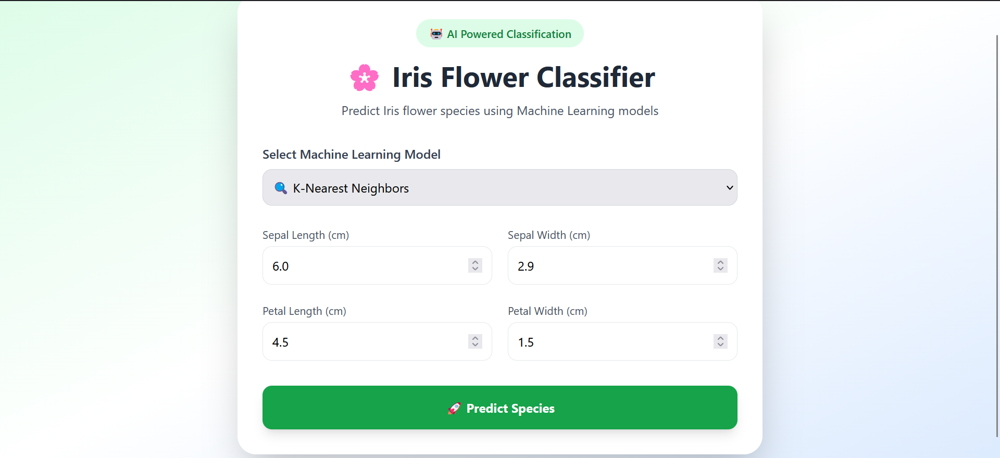
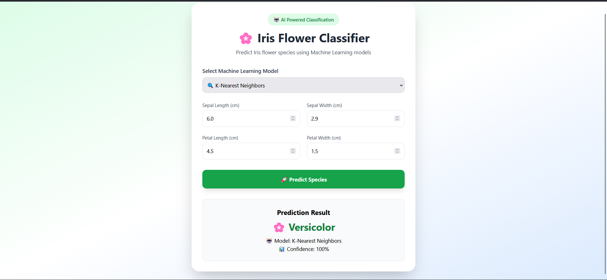
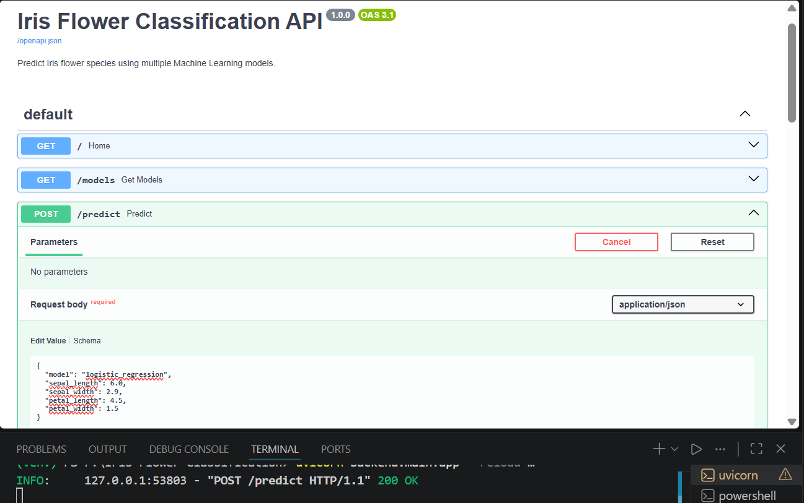
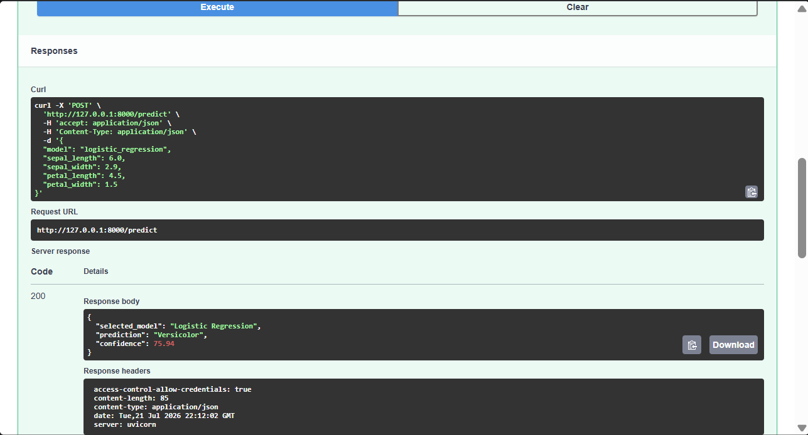

# 🚗 Car Price Prediction System

> A full-stack Machine Learning web application for used car price prediction using seven Machine Learning algorithms, FastAPI, SQLite, and a custom-designed dashboard-style frontend.


---

# 📖 Overview

The Car Price Prediction System is an end-to-end Machine Learning application that predicts the selling price of a used car based on its specifications, using seven supervised regression algorithms.

The project demonstrates the complete ML deployment workflow, including:

- Data cleaning and feature engineering
- Model training and evaluation across seven algorithms
- REST API development using FastAPI
- Interactive Swagger documentation
- A custom, dashboard-styled web frontend
- SQLite prediction history
- Real-time predictions with automatic reversal of a log-transformed target

---

# ✨ Features

- 🚗 Used car selling price prediction
- 🤖 Seven trained Machine Learning models, dynamically selectable
- 📊 Model performance comparison (MAE, RMSE, R²)
- ⚡ FastAPI REST API
- 📖 Interactive Swagger documentation
- 🎨 Custom automotive-dashboard frontend with a gauge visualization
- 🗄 SQLite prediction history
- 🔄 Dynamic model selection
- ✅ Request validation using Pydantic
- 🧮 Automatic log-price reversal, so predictions are returned in real currency

---

# 🛠 Tech Stack

| Category | Technologies |
|-----------|--------------|
| Language | Python |
| Machine Learning | Scikit-learn, XGBoost, CatBoost |
| Backend | FastAPI |
| Frontend | HTML, CSS, JavaScript |
| Database | SQLite |
| API Documentation | Swagger UI |
| Model Serialization | Joblib |

---

# 📁 Project Structure

```text
car-price-prediction/
│
├── backend/
├── frontend/
├── models/
├── database/
├── notebook/
├── assests/
├── README.md
├── Documentation.md
└── LICENSE
```

---

# 📊 Machine Learning Models

| Model | MAE | RMSE | R² Score |
|---|---:|---:|---:|
| Optimized CatBoost | 0.1210 | 0.1634 | 94.52% |
| CatBoost | 0.1220 | 0.1645 | 94.45% |
| XGBoost | 0.1266 | 0.1706 | 94.02% |
| Random Forest | 0.1291 | 0.1773 | 93.55% |
| Linear Regression | 0.1409 | 0.1887 | 92.69% |
| Gradient Boosting | 0.1426 | 0.1909 | 92.52% |
| Decision Tree | 0.1644 | 0.2261 | 89.51% |

*MAE/RMSE are measured on the log-price scale the models were trained on — see `models/README.md` for details.*

---

# 📸 Application Preview

## 🏠 Home Page

<p align="center">

</p>

---

## 🚗 Prediction Result

<p align="center">

</p>

---

## 📖 Swagger Documentation

<p align="center">

</p>

---

## 🔍 Prediction API

<p align="center">

</p>

---

# 🚀 Installation

```bash
git clone https://github.com/your-username/car-price-prediction.git

cd car-price-prediction

python -m venv venv

venv\Scripts\activate

cd backend

pip install -r requirements.txt

uvicorn main:app --reload
```

**Note:** the trained model files require `scikit-learn==1.6.1` specifically. Installing a newer version can break loading the saved pipelines — this is already pinned in `requirements.txt`, so a plain `pip install -r requirements.txt` is all that's needed.

Frontend:

Open the `frontend` folder using Live Server, or open `index.html` directly in your browser.

---

# 🌐 API Endpoints

| Method | Endpoint |
| ------ | -------- |
| GET | / |
| GET | /models |
| POST | /predict |
| GET | /latest_prediction |

---

# 🚀 Future Improvements

* Prediction history dashboard (currently only the latest prediction is exposed)
* Docker deployment
* PostgreSQL integration
* CI/CD pipeline
* Cloud deployment
* Dynamic gauge scaling based on live dataset statistics

---

# 📚 Documentation

This README provides a quick overview of the project.

For detailed technical documentation covering:

* Project Architecture
* Feature Engineering (`km_per_year`, `log_km_driven`, log-price target)
* Machine Learning Pipeline
* Backend (FastAPI)
* Frontend
* SQLite Database
* API Documentation
* Testing
* Deployment
* Future Improvements

please refer to:

## 📖 [Documentation.md](Documentation.md)

---

# 👨‍💻 Author

**[Your Name]**

Computer Science & Artificial Intelligence Graduate

* LinkedIn: [https://linkedin.com/in/your-profile](https://linkedin.com/in/your-profile)
* GitHub: [https://github.com/your-username](https://github.com/your-username)

---

# ⭐ If you found this project useful, consider giving it a star!